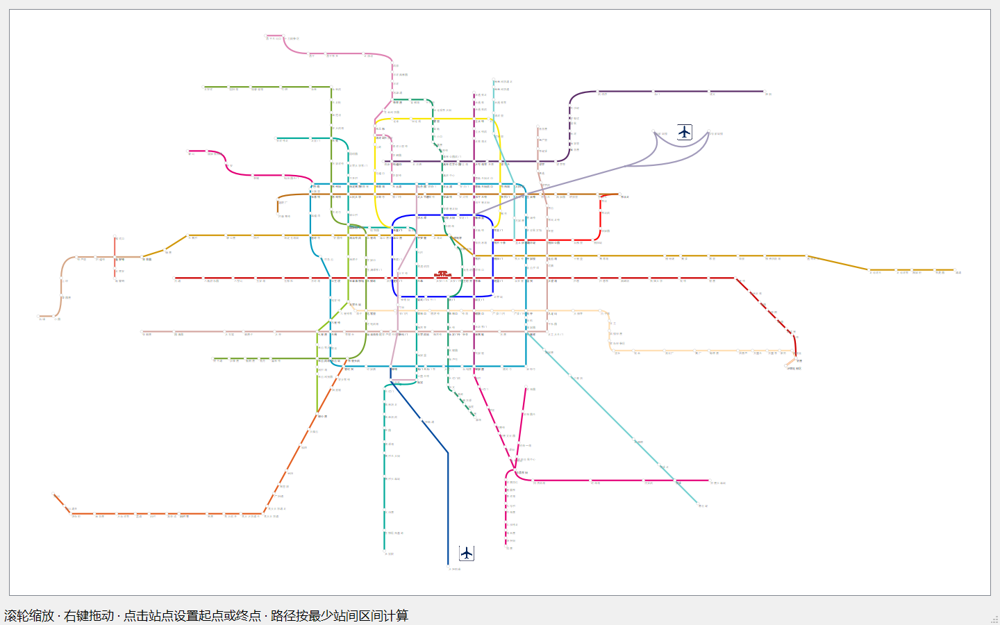
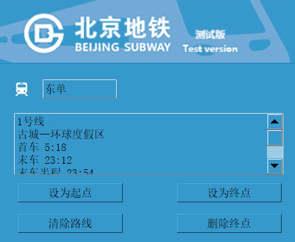
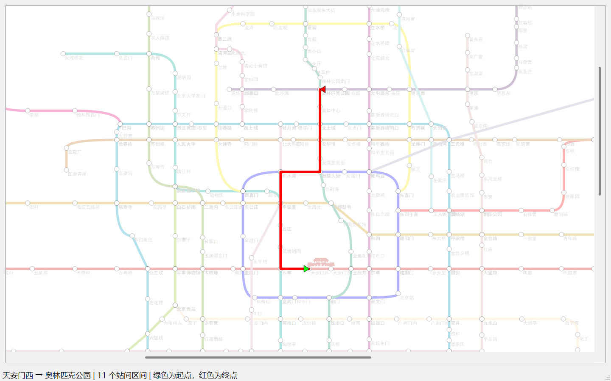

# 北京地铁线路图（Qt）

基于 Qt 的地铁线路展示与路径查询规划。

基于 **C++17 与 Qt Widgets** 的交互式北京地铁线路查询桌面程序。用图形场景绘制地铁网络，通过站点弹窗选择起终点，并用 Floyd–Warshall 算法计算、展示经过站间区间最少的路线。



## 功能

- **线路地图**：加载项目附带的 28 组线路数据，按线路颜色绘制站点、名称和转弯。
- **交互浏览**：滚轮缩放，按住鼠标右键拖动地图。
- **站点信息**：左键点击站点，查看所属线路及附带的线路说明。
- **路径查询**：选择起点、终点后高亮路线，标出起终点，并显示站间区间数量。
- **路线重选**：支持替换终点、删除终点、清除整条路线。
- **资源随程序携带**：运行数据与图片编入 Qt 资源，无需修改本机路径或复制数据目录。

## 界面展示

### 站点信息

以东单站为例，弹窗展示换乘线路，并提供起点、终点及清除操作。



### 路线查询

示例：天安门西 → 奥林匹克公园。红色线段表示查询路线，绿色标记为起点，红色标记为终点。



这些图片来自本项目实际编译运行的 Qt 界面。截图生成程序位于 `tests/capture_screenshots.cpp`。

## 技术实现

| 部分 | 实现 |
| --- | --- |
| 编程语言 | C++17 |
| 桌面界面 | Qt Widgets、Qt Designer |
| 地图绘制 | QGraphicsScene、QGraphicsView、QPainterPath |
| 交互通信 | Qt 信号与槽 |
| 路径计算 | Floyd–Warshall 全源最短路径与路径重建 |
| 数据与图片 | Qt Resource System（`.qrc`），运行文本统一 UTF-8 |
| 构建与测试 | qmake、Qt Test |

相同名称的站点合并为图中的同一个顶点，相邻站点之间建立权重为 1 的双向边。Floyd–Warshall 预计算所有站点对的距离，再通过后继矩阵重建起终点间的路径。预计算时间复杂度为 O(V³)，空间复杂度为 O(V²)。

**查询目标是最少站间区间，尚未引入实际里程、运行时间、换乘惩罚或票价。** 线路数据中保留了原有的部分绘图辅助节点，可能影响区间统计；结果适合算法与界面演示。

## 构建运行

本次验证环境：**Windows x64、Qt 5.15.2、MSVC 2022（19.41）、Release 构建**。本机使用已有的 Anaconda Qt 开发库；项目不依赖 Python，使用独立 Qt 安装也可打开工程。其他平台与 Qt 版本尚未验证。

### 使用 Qt Creator

1. 安装包含 Qt Widgets 和 qmake 的 Qt 开发环境，以及与所选 Qt 套件兼容的 C++ 编译器。
2. 在 Qt Creator 中打开根目录的 `Subway.pro`。
3. 选择桌面构建套件，构建并运行。

数据和图片均来自 `imageResource.qrc`，无需修改源码中的目录。`Subway.pro.user` 属于本机 Qt Creator 配置，已加入忽略规则。

### Windows 命令行（MSVC）

在已配置 MSVC 环境、且可调用 `qmake` 的开发者命令提示符中，从项目根目录执行：

```bat
mkdir build\app
cd build\app
qmake ..\..\Subway.pro "CONFIG+=release" "CONFIG-=debug_and_release"
nmake
Subway.exe
```

运行时仍需可用的 Qt 动态库与平台插件；打包给未安装 Qt 的电脑时，需要额外部署 Qt 运行库。

> 本次使用的旧版 Anaconda Qt 与 MSVC 2022 组合在生成 `moc_predefs.h` 时发生编译器异常；为此，验证时在 qmake 命令中额外传入了 `"CONFIG+=no_moc_predefs"`。这是该构建环境的兼容选项，没有写死在项目配置中。

## 使用方法

1. 启动后显示完整线路地图；将鼠标移到目标区域，滚动滚轮放大。
2. 左键点击站点，在弹窗中点击「设为起点」。
3. 点击另一个站点，再点击「设为终点」，查看高亮路线和底部结果。
4. 再次设置终点会替换原终点；「删除终点」会保留起点；「清除路线」会清空选择。
5. 设置新的起点会开始一次新的查询。

## 测试与截图复现

从项目根目录，在相同的开发者命令环境中运行：

```bat
mkdir build\tests
cd build\tests
qmake ..\..\tests\showcase_tests.pro "CONFIG+=release"
nmake
showcase_tests.exe
```

测试覆盖异地工作目录下的嵌入资源、中文站点和全部线路说明、重复加载、已知路线、按钮单次触发、终点删除、弹窗释放、站点线路信息及地图交互。最新验证记录见 [发布整理报告](docs/RELEASE_PREPARATION.md)。

重新生成三张展示截图前，请先回到项目根目录，再执行：

```bat
mkdir build\capture
cd build\capture
qmake ..\..\tests\capture_screenshots.pro "CONFIG+=release"
nmake
capture_screenshots.exe ..\..\docs\screenshots
```

截图工具在 Windows 桌面环境中打开真实程序，直接截取程序自身的 Qt 窗口和站点弹窗，保存总览、站点信息、路线查询三张 PNG。

## 项目结构

```text
Subway.pro                 qmake 工程入口
main.cpp                   应用入口
mainwindow.cpp/.h          主窗口与起终点状态
Subway.cpp/.h              数据读取、站点合并、Floyd 路径计算
Line.cpp/.h                线路与站点绘制
Station.h                  站点数据结构
ZoomableView.cpp/.h        地图缩放、拖动、站点点击、路径高亮
stationpopupui.*           站点信息弹窗
imageResource.qrc          运行数据与图片资源清单
Data2/                     当前运行数据（UTF-8）
Resource/                  地图与弹窗图片
Data/、SourseData/          历史数据，保留原始内容
legacy/                    未完成的历史数据预处理草稿，不参与构建
tests/                     回归测试与截图工具
docs/screenshots/          README 使用的实际界面截图
```

## 数据与授权

线路信息和时刻说明来自项目原有的静态数据，本次整理没有核验或更新其运营时效，请勿将其用于实时出行决策。

本项目尚未添加 `LICENSE`；图片及历史数据的来源、授权说明也有待补充。发布时应保留这一状态说明，待作者确定授权范围后再添加对应许可证。
